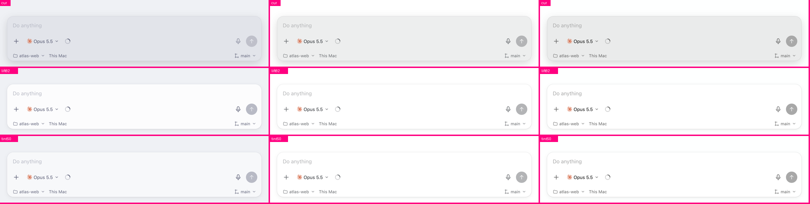

# cmux NEXT agent-pane surfaces: one token, three wrong light themes

2026-10-14, cg-design-judge lane on cosmic-gray. Three Thunderdomes on the real web components (`webviews` gallery, feat-cmux-next `ee8d80672c35`), one CSS override per contender, six terminal themes, blind agent judges with declared lenses.

Domes and full results:
- [`experiments/thunderdome/examples/cmux-composer/`](../../experiments/thunderdome/examples/cmux-composer/RESULTS.md): 132 blind bouts, 3 judges
- [`experiments/thunderdome/examples/cmux-new-tab/`](../../experiments/thunderdome/examples/cmux-new-tab/RESULTS.md): 40 blind bouts
- [`experiments/thunderdome/examples/cmux-permission-card/`](../../experiments/thunderdome/examples/cmux-permission-card/RESULTS.md): 40 blind bouts

## Context

A daily-driver agent app, used for hours, in whatever terminal theme the user runs (Catppuccin, Apple System Colors, GitHub Light, Tokyo Night). The composer is the hot path. New Tab opens fifty times a day. The permission card is rare, but it carries consequence.

## Reaction

In light themes the composer, the New Tab box and the permission card all looked like grey slabs, as if the input were switched off. In dark they looked fine.

## Diagnosis

All three fill with `color-mix(in srgb, var(--agent-text) N%, var(--base))`. Mixing the text color in lightens a dark theme and darkens a light one, so one token gives two opposite designs: a raised card in dark, and a sunken well in light, which reads as a disabled field. It also breaks Leo's decided rule that light composers sit lighter than the page.

## What the domes showed

- **The card needs a fill step.** A page-colored card with only a rim lost everywhere (4–20). It reads as a stroked hole.
- **Dark:** keep the tonal step and drop the `0 8px 24px 18%` shadow. It is invisible on dark pages and muddy on light ones.
- **Light:** step up, not down. Mix toward white at about 50% over the theme base, so tinted themes stay in palette. Two of three judges called a pure-white card on Latte "off-theme". On pure-white pages the lift has to come from a .5px rim plus a small two-layer shadow (`0 1px 2px 6%, 0 3px 12px 6%`).
- **State shapes have to mean their state.** The context ring's partial arc reads as a loading spinner at every stroke weight. A filled wedge reads as a gauge (18–0). An idle Send at accent 34% reads half-enabled, while a faint 9% disk keeps the target and reads off (16–2).
- **A consequence needs a visible signal.** On the permission card, ranking the buttons helped, but the sentence explaining that "Allow for this chat" covers future requests is the only thing that made the bigger grant read as bigger. Hiding it went 0–16.

## Judgment

Keep: the tonal step in dark; the .5px rim; one Send shape across states; the scope sentence on the permission card.
Change: light fills step up from the page; drop the 24px shadow; the ring becomes a wedge; the empty Send becomes a faint disk; the permission card loses "Expand details" and ranks its buttons.
Reject: flat page-colored cards; bare-arrow and outline Sends; moving consequence copy into tooltips.
Unresolved: none of these were seen in the native app on a real display (the Mac was locked). Confirm on nightly-next once op-next-theme and the composer footer lane land.

## What got stronger

- **Pattern candidate: theme-relative tokens must be checked in both brightnesses.** "Text at N% over the page" is a two-design token. It is one case so far, across three surfaces. Promote it when a second product shows the same flip.
- SIGNATURE "Make hot paths direct" gains a visual corollary: **a control's resting look must not resemble a different state** (disabled, loading, ready).
- **Method:** a fork that judged its own variants picked "all three changes" 16–0. Blind judges ranked the same stack 6–10. Self-judging after authoring is not evidence.

## Follow-up: sidebar rows (same day)

[`experiments/thunderdome/examples/cmux-sidebar-rows/`](../../experiments/thunderdome/examples/cmux-sidebar-rows/RESULTS.md): 108 blind bouts on native tunables. The same principle carried over: the status slot must carry state, so a brand mark that displaced it lost 0–12. The bigger finding came from looking rather than voting. A failed run is drawn exactly like routine work, while decorative group bands are the loudest thing in the column. That is SHITLIST's "healthy activity represented as attention demand" turned inside out: attention demand represented as healthy activity.
