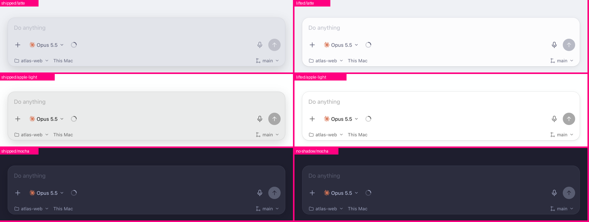
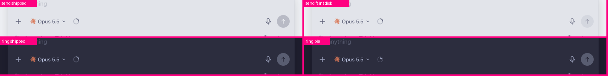

# Composer Thunderdome: results (2026-10-14)

The real cmux NEXT composer (`webviews` gallery entry `agent-pane.composer`, feat-cmux-next `ee8d80672c35`), with one CSS override per contender, shot at 2x in six terminal themes (three light, three dark), idle and focused. Three blind agent judges, each with a declared lens (Apple-native craft, heavy daily user on Catppuccin, anti-trend skeptic), each covering two themes: 132 bouts, each with a one-line reason. `votes.json` is the raw export, and `node cli.mjs results cmux-composer --votes examples/cmux-composer/votes.json` reproduces the tables.

Native captures of the DEV app were blocked: the Mac was locked, so the window could not draw. The gallery runs the same React and CSS as the app's webview.

## Composer Thunderdome

### Which composer card would you rather type into all day?

| # | | Elo | W–L–T |
|---:|---|---:|---:|
| 1 | As shipped | 1594 ±80 | 12–4–8 |
| 2 | Well, no shadow | 1571 ±79 | 12–6–6 |
| 3 | Lifted | 1525 ±80 | 10–8–6 |
| 4 | Soft float | 1503 ±75 | 8–8–8 |
| 5 | Flat + rim | 1307 ±113 | 4–20–0 |

As shipped and Well, no shadow are too close to call: 58% of resamples put As shipped ahead.

### Empty draft: which Send reads right?

| # | | Elo | W–L–T |
|---:|---|---:|---:|
| 1 | Faint disk | 1714 ±114 | 16–2–0 |
| 2 | As shipped | 1467 ±99 | 8–10–0 |
| 3 | Outline | 1409 ±100 | 6–12–0 |
| 4 | Ghost arrow | 1409 ±114 | 6–12–0 |

Faint disk is ahead of As shipped in 100% of resamples.

### 24% of context used: which ring?

| # | | Elo | W–L–T |
|---:|---|---:|---:|
| 1 | Pie | 1854 ±109 | 18–0–0 |
| 2 | Hidden under 50% | 1601 ±75 | 12–6–0 |
| 3 | Thin gauge | 1272 ±76 | 0–12–6 |
| 4 | As shipped | 1272 ±76 | 0–12–6 |

Pie is ahead of Hidden under 50% in 100% of resamples.

## Verdicts and levers

### Context ring → Pie (18–0–0)

**Lever:** shape semantics. A partial arc on a track is the system's activity-indicator shape, so at 16px it reads as "loading" at every stroke weight (Thin vs As shipped: six ties). A filled wedge is a gauge. Hiding the ring beat the arc, because a fake busy signal costs more trust than losing a 24% reading. The pie beat hiding because it shows the value without the misread.

**Change:** draw the usage as a filled wedge inside a 1px track ring.

### Empty Send → Faint disk (16–2–0)

**Lever:** keep the target, drop the weight. The shipped accent-34% disk is nearly as heavy as the ready state, so it reads as half-enabled. A bare arrow loses the target and blends with the mic glyph. An outline ring is a third circle next to the context ring, and judges called it "a second spinner".

**Change:** idle disk at text 9%, arrow at text 45%. Only the color changes when a draft arrives.

### Card surface: dark → no drop shadow; light → a call for Leo

- **Dark, all judges:** the tonal step (text ~8% over the page) is right. The `0 8px 24px 18%` shadow adds nothing visible on Mocha or Tokyo Night. "Well, no shadow" leads dark.
- **Flat + rim lost everywhere (4–20).** A page-colored card with only a rim reads as a stroked hole or a frame, not a place to type. The card needs a fill step.
- **Light, split.** The Apple-lens judge picked lighter-than-page (white card, .5px rim, small two-layer shadow) because the grey well "reads as a sunken, disabled field". The heavy-user and skeptic judges picked the shipped tinted well: on a pure-white page a white card leans entirely on its rim, and pure white looks off-theme on Catppuccin Latte.

**Named conflict:** "lighter than the page" cannot hold when the page is already white. The lever is where the fill step comes from: down (the tinted well, which reads disabled) or up (lifted, which needs a rim and a shadow on white pages and looks off-theme on tinted ones).

**Lane recommendation:** follow Leo's stated rule. Light themes use Lifted, but with the fill mixed toward white at about 50% over the theme base rather than 82%, so Latte stays Latte. Keep the .5px rim at 13% and replace the 24px bloom with `0 1px 2px 6%, 0 3px 12px 6%`. Dark keeps the tint and drops the shadow.

Keep: the tonal-step fill in dark; the .5px rim; one shared Send shape across states.
Change: ring → pie; idle Send → faint disk; drop the 24px/18% shadow; light fill steps up, not down.
Reject: Flat + rim; Ghost arrow; Outline send.
Follow-up, same session: the theme-tinted lift (white 50% over the base) was rendered in three light themes (below: shipped / lift 82% / lift 50%). On Latte it stays in palette and still sits lighter than the page, which answers the "off-theme" objection. On pure-white pages (GitHub Light, Apple Light) it is the same as lift 82%, a white card carried by its rim and a small shadow.

**Decided (Leo): light composers sit lighter than the page.** op-next-theme is implementing it, so this dome confirms the decision; it does not reopen it. What the dome adds for that implementation:
- Mix toward white at about 50% over the theme base, not 82%, so tinted light themes (Latte) stay in palette. Two of three blind judges marked a pure-white card on Latte "off-theme".
- On pure-white pages the lift cannot come from fill, so it comes from the .5px rim plus the small two-layer shadow. Don't drop the rim there.
