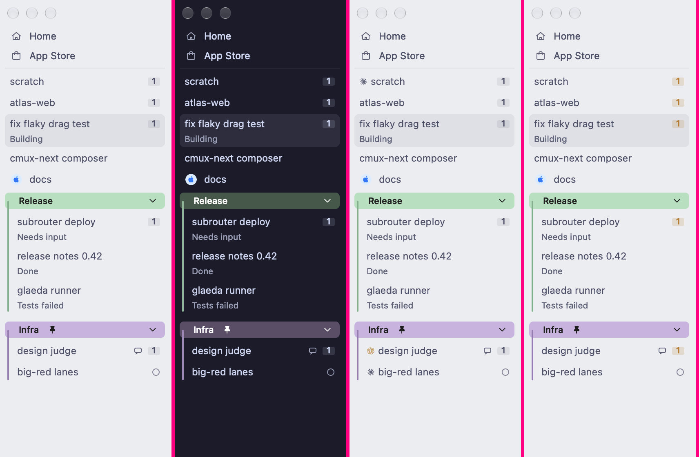

# Sidebar Rows Thunderdome: results (2026-10-14)

The native cmux NEXT sidebar (the cg-judge DEV build of feat-cmux-next `ee8d80672c35`), captured with the app's own `debug.window_snapshot`. That works with the Mac locked, because the sidebar is AppKit. The seed is 10 workspaces, two groups, statuses, agent states and unread counts. Each contender is one runtime Debug tunable (`rpc debug.tunables`), shot in four themes. Three blind judges (Apple-native, heavy daily user, skeptic) cast 108 bouts. `votes-blind.json` is the raw export.

## Sidebar Rows Thunderdome

### Where does the agent show up on a row?

| # | | Elo | W–L–T |
|---:|---|---:|---:|
| 1 | As shipped | 1673 ±112 | 10–2–0 |
| 2 | Mark beside title | 1590 ±111 | 8–4–0 |
| 3 | Mark replaces status | 1237 ±104 | 0–12–0 |

As shipped and Mark beside title are too close to call: 80% of resamples put As shipped ahead.

### Which unread count?

| # | | Elo | W–L–T |
|---:|---|---:|---:|
| 1 | As shipped | 1716 ±108 | 15–3–0 |
| 2 | Tone | 1716 ±104 | 15–3–0 |
| 3 | Outline | 1322 ±106 | 4–14–0 |
| 4 | Quiet | 1246 ±104 | 2–16–0 |

As shipped and Tone are too close to call: 52% of resamples put As shipped ahead.

### How tall are rows?

| # | | Elo | W–L–T |
|---:|---|---:|---:|
| 1 | 22pt | 1673 ±123 | 10–2–0 |
| 2 | 24pt (shipped) | 1590 ±107 | 8–4–0 |
| 3 | 28pt (Codex/Claude pitch) | 1237 ±93 | 0–12–0 |

22pt and 24pt (shipped) are too close to call: 79% of resamples put 22pt ahead.

### Item corner radius

| # | | Elo | W–L–T |
|---:|---|---:|---:|
| 1 | 6pt (shipped) | 1534 ±58 | 2–0–10 |
| 2 | 4pt | 1534 ±55 | 2–0–10 |
| 3 | 9pt | 1432 ±60 | 0–4–8 |

6pt (shipped) and 4pt are too close to call: 50% of resamples put 6pt (shipped) ahead.

### Home and App Store

| # | | Elo | W–L–T |
|---:|---|---:|---:|
| 1 | Icon tiles | 1573 ±132 | 8–4–0 |
| 2 | As shipped | 1573 ±107 | 8–4–0 |
| 3 | Card | 1353 ±129 | 2–10–0 |

Icon tiles and As shipped are too close to call: 53% of resamples put Icon tiles ahead.

## Verdicts

- **Agent mark: keep it off (status glyph only).** Putting the brand mark in the status slot lost 0–12. A brand says who is running; the glyph says whether it needs you, and that is the sidebar's job. A leading mark beside the title came close (8–4), but it leaves the title edge ragged when only some rows have it. This supports Lawrence's 10-14 call (cx-im75u: rows draw no brand or kind glyph).
- **Unread badge: keep the neutral filled chip.** The tone wash tied it, winning in dark and losing in light, where gold on cream is low contrast. A bare digit (2–16) and a hairline box (4–14, "reads as a keycap") lost.
- **Row pitch: keep the compact default and never go to 28pt (0–12).** 22pt edged out 24pt (10–2 vs 8–4), but that's not decisive enough to justify moving a default.
- **Corner radius: not a lever at this size.** 10 of 12 bouts were ties. The metric moves only the group-header corners, not the selection fill. 9pt starts to read as a capsule on the header band.
- **Home / App Store: the labeled rows and the icon tiles tie; the card loses (2–10).** The card's fill matches a selected row's, so the destinations look selected.

## What the tunables could not test (the real findings)

These came from looking at the shipped capture, not from the votes. They need code, not tunables:

1. **Status is invisible.** "Tests failed", "Needs input", "Done" and "Building" are all the same grey subtitle. The one row that needs attention has no color and no glyph, and `status set --state busy` draws no activity glyph at all. A failure is drawn exactly like routine work.
2. **Group headers are the loudest thing in the column.** Solid pastel bands outrank every status, so the eye lands on "Release" before the failed test. The colors are fixed pastels, identical in Latte and Apple Light, not theme-derived.
3. **The unread "1" is on half the rows, so it stops carrying meaning.** Agent events seem to mark workspaces unread on their own.
4. **A status subtitle doubles the row (24 → 40pt),** so the list's pitch jumps with state. A fixed trailing glyph slot keeps the geometry stable.

Next round, once these can be flagged: status as a colored trailing glyph vs a tinted subtitle; a group header as a band vs a text label plus color line.
